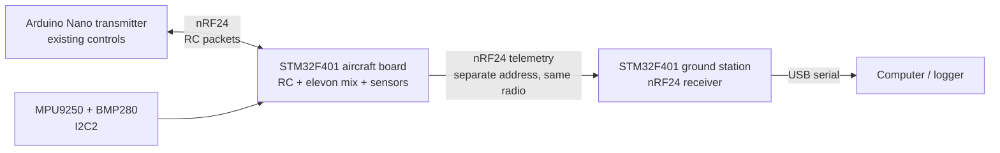

# NanoLink

An evolving DIY fixed-wing RC and flight-telemetry project. The current stage
keeps the existing Arduino Nano transmitter and its nRF24 control link, moves
the aircraft receiver/flight-control work to an STM32F401, mixes two elevon
servos, and sends MPU9250 + BMP280 telemetry to a second STM32F401 connected to
a computer over USB. The aircraft itself does not need a USB connection during
operation.

This is a hobby prototype, not certified flight-control equipment. The current
firmware is **manual-control + sensor-telemetry only**: stabilization, GPS,
computer-issued aircraft commands, and autonomous flight are not implemented.
Do not treat a successful build as flight-ready firmware.

## Current scope

- Keep the existing Nano transmitter's RF channel, rate, address, packet shape,
  and pin assignments compatible.
- Keep the aircraft F401 nRF24 SPI/CE/CSN wiring as documented below.
- Convert the receiver's aileron/elevator commands into left/right elevon
  outputs; retain a separate ESC output.
- Read MPU9250 acceleration, gyro and magnetometer, plus BMP280 temperature
  and pressure on the aircraft.
- Use the aircraft's single nRF24 radio for RC reception and scheduled,
  low-rate telemetry transmission. The ground F401 listens on the telemetry
  address and forwards readings to the computer over USB serial.
- Preserve the arm switch as a hard motor gate. On loss of RC packets, motor
  output goes to the configured ESC idle pulse and surfaces go to neutral.

## Hardware layout



The flight controller alternates briefly between listening for RC and sending
telemetry. The ground station is receive-only for now. Computer-to-aircraft
commands and GPS data are intentionally deferred. Because RC and telemetry
share one radio, the flight controller sends telemetry only after receiving a
valid RC packet; it then returns to the RC listening address. Do not add a
second aircraft radio or change the RF schedule without updating the protocol
and testing coexistence.

## Existing Nano transmitter wiring (unchanged)

These assignments are retained from the existing transmitter documentation.

| Nano pin | Signal |
|---|---|
| D9 / D10 | nRF24 CE / CSN |
| D11 / D12 / D13 | nRF24 MOSI / MISO / SCK |
| A0 / A1 | Elevator / aileron stick |
| A2 | Throttle stick |
| A3 | Unused stick axis |
| A4 / A5 | Throttle-boost / spare potentiometer (**A5 is known to be faulty**) |
| A6 / A7 | Arm switch / throttle-mode switch |
| D3–D6 | Elevator and aileron trim buttons |
| D7 / D8 | Reserved trim inputs |

The transmitter continues to send the existing 12-byte packet. The faulty A5
potentiometer is not used by the new aircraft firmware. The existing throttle
mode switch still controls the transmitter's throttle curve; it is not silently
reassigned to stabilization.

## Aircraft STM32F401 wiring

The RF pin assignments remain unchanged. The two elevons use the existing
aileron/elevator PWM pins, and the ESC keeps its existing PWM pin.

| Signal | STM32F401 pin | Notes |
|---|---|---|
| nRF24 CE / CSN | PB0 / PA4 | Keep the existing wiring |
| nRF24 SCK / MISO / MOSI | PA5 / PA6 / PA7 (SPI1) | Keep the existing wiring |
| Left elevon PWM | PB6 (TIM4_CH1) | Former aileron output |
| Right elevon PWM | PB7 (TIM4_CH2) | Former elevator output |
| ESC PWM | PB8 (TIM4_CH3) | Verify ESC idle with propeller removed |
| MPU9250 + BMP280 SDA | PB3 (I2C2) | PB3 is also SWO; firmware does not use SWO |
| MPU9250 + BMP280 SCL | PB10 (I2C2) | STM32duino `TwoWire` uses SDA, SCL order |
| Link LED | PC13 | Existing board LED, active-low |
| Sensor power / ground | 3V3 / GND | Feed the breakout's VIN/VCC input with 3.3 V; do not feed a breakout's 3V3 output pin |

```text
F401 3V3  -> sensor VIN/VCC input (not the breakout's 3V3 output)
F401 GND  -> sensor GND
F401 PB3  -> sensor SDA
F401 PB10 -> sensor SCL
```

For the common GY-91-style breakout, I2C uses power, ground, SDA and SCL;
SDO/SA0 may select the MPU address, while NCS/CSB are SPI-select pins. Check
the exact board's pin labels/default straps before leaving these pins open.
MPU9250 address is usually `0x68` or `0x69`; BMP280 is usually `0x76` or
`0x77`. Firmware tries both common BMP280 addresses. Check onboard I2C pull-ups
before adding any; do not apply BEC 5 V to sensor I/O.

The EBYTE E01-2G4M27D VCC input accepts 2.5–5.5 V, but its SPI/control logic is
3.3 V. A stable 5 V BEC supply is permitted; the module can draw large TX
current bursts (around 390 mA at 5 V). Keep a common ground and local
decoupling near the radio. Check that the BEC can power the STM32, radio and
both servos together. Do not connect aircraft USB while the BEC is powering
the board: this Black Pill variant may tie USB VBUS directly to its 5 V rail.

## Ground station wiring

Use another STM32F401 + nRF24 module. Radio wiring is the same as the aircraft
board: CE PB0, CSN PA4, SPI1 PA5/PA6/PA7, and 3.3 V logic. Power the ground
station from its USB cable only. Connect it to the computer by USB; the aircraft
is not connected to the computer.

## Firmware and build

Projects are separate PlatformIO environments in `firmware/`:

```sh
pio run -d firmware/aircraft_f401
pio run -d firmware/ground_station_f401
```

The aircraft build has no USB CDC data path. The ground station prints one CSV
record per received telemetry packet at 115200 baud. Configure the computer's
serial monitor to 115200, 8-N-1.

Flight-control directions, servo endpoints, sensor orientation, and ESC idle
must be checked with the propeller removed before any powered test. The current
elevon mixer preserves the transmitter commands but its final servo direction
depends on linkage geometry; verify that pull-up raises both elevons and
aileron-right raises the right elevon while lowering the left. If not, change
the mixer signs in the aircraft source and re-check.

## Roadmap

1. Bench-check the sensor I2C wiring and computer telemetry link.
2. Verify RC failsafe, arming and elevon directions without a propeller.
3. Add gyro rate damping, then a selectable self-level mode with manual override.
4. Add GPS position telemetry for recovery; no GPS flight commands yet.
5. Consider computer-sent commands only after the RC-priority and link-loss
   behavior are tested.

GPS is not a substitute for IMU calibration and does not directly remove
attitude drift. Initial GPS scope is position reporting/logging only. If the
radio link is lost, a separate onboard location log or beeper will be needed
for recovery.
