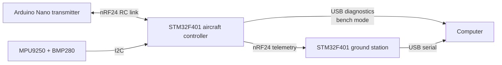

# NanoLink

NanoLink is an open DIY control and telemetry system for fixed-wing RC aircraft.
It combines a handheld radio transmitter, an STM32-based aircraft controller,
  a computer-connected ground station, and a desktop debug monitor.

## System



- **Transmitter:** reads pilot controls and sends throttle, roll, pitch, arming,
  and auxiliary control data.
- **Aircraft controller:** receives pilot commands, drives the motor ESC and two
  elevon servos, and reads the onboard motion and pressure sensors.
- **Ground station:** receives aircraft sensor data and makes it available to a
  computer over USB serial. The aircraft does not need a computer connection
  during operation.

The current firmware supports manual RC control with dual-rate throw, elevon
mixing, a self-level stabilization mode (selected with the transmitter's
3-position switch), link-loss failsafe, MPU9250/BMP280/GPS data acquisition,
and nRF24 telemetry.

The radio link is **role-based and fire-and-forget**: the transmitter only
sends, the ground station only listens, and the aircraft stays in receive mode
almost continuously, sending a full telemetry snapshot (sensor + control + GPS)
every 3 seconds or when a transmitter trigger button is pressed. Two unused
throttle-stick trim buttons act as triggers (telemetry dump and a draft
return-to-home request). Autonomous navigation is not part of the current
release.

## Hardware

The reference build uses an Arduino Nano transmitter, STM32F401 boards for the
aircraft controller and ground station, nRF24-compatible radios, and an
MPU9250 + BMP280 sensor module. Hardware connections and power requirements are
listed in the [hardware guide](docs/hardware-wiring.md).

## Firmware projects

Each unit has an independent PlatformIO project:

| Project | Location | Board |
|---|---|---|
| Handheld transmitter | `firmware/transmitter_nano/` | Arduino Nano / ATmega328P |
| Aircraft controller | `firmware/aircraft_f401/` | STM32F401 Black Pill |
| Computer ground station | `firmware/ground_station_f401/` | STM32F401 Black Pill |

Build instructions and radio packet details are available in the project
directories and [system design](docs/system-design.md).

## Flashing

A single helper builds and flashes each unit, waiting for the programmer and
retrying the upload so it works on the first attempt:

```sh
./tools/flash.sh build        # compile all three firmwares
./tools/flash.sh aircraft     # flash the aircraft controller (ST-Link)
./tools/flash.sh gcs          # flash the ground station (ST-Link)
./tools/flash.sh tx           # flash the Nano transmitter (USB serial)
./tools/flash.sh monitor gcs  # open the serial monitor
```

The STM32 projects patch the stm32duino SPI driver at build time (see
`firmware/common/spi_fix.py`) to work around an SPI1 enable bug on the F401/F411
Black Pill that otherwise hangs the radio link. The fix is applied automatically
and survives framework reinstallation.

## Desktop debug monitor

`ground_app/` contains a read-only visual monitor with two connection modes:

- **Direct USB diagnostics:** connect the aircraft F401 to inspect IMU, barometer,
  and GPS data. This diagnostic firmware disables nRF reception and PWM outputs.
- **Ground-station telemetry:** connect the computer to the ground F401 to inspect
  radio status, aircraft-reported RC inputs, sensor data, GPS, and packet counters.

See [`ground_app/README.md`](ground_app/README.md) for installation and use.

## Safety

NanoLink is an experimental hobby project, not certified flight-control
equipment. Verify control directions, arming, failsafe behavior, power wiring,
and sensor readings on the bench before flight. Remove the propeller during
initial electrical and control-surface checks.
