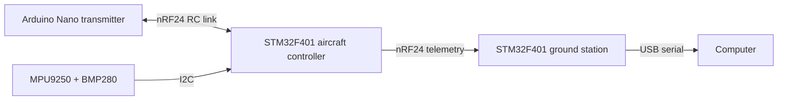

# NanoLink

NanoLink is an open DIY control and telemetry system for fixed-wing RC aircraft.
It combines a handheld radio transmitter, an STM32-based aircraft controller,
and a computer-connected ground station.

## System

- **Transmitter:** reads pilot controls and sends throttle, roll, pitch, arming,
  and auxiliary control data.
- **Aircraft controller:** receives pilot commands, drives the motor ESC and two
  elevon servos, and reads the onboard motion and pressure sensors.
- **Ground station:** receives aircraft sensor data and makes it available to a
  computer over USB serial. The aircraft does not need a computer connection
  during operation.

The current firmware supports manual RC control, elevon mixing, link-loss
failsafe, and sensor telemetry. Flight stabilization, GPS, and computer-issued
flight commands are not part of the current release.

## Hardware

The reference build uses an Arduino Nano transmitter, STM32F401 boards for the
aircraft controller and ground station, nRF24-compatible radios, and an
MPU9250 + BMP280 sensor module. Hardware connections and power requirements are
listed in the [hardware guide](docs/hardware-wiring.md).

## Firmware projects

Each unit has an independent PlatformIO project:

| Project | Location | Board |
|---|---|---|
| Handheld transmitter | `firmware/transmitter_nano/` | Arduino Nano / ATmega328P |
| Aircraft controller | `firmware/aircraft_f401/` | STM32F401 Black Pill |
| Computer ground station | `firmware/ground_station_f401/` | STM32F401 Black Pill |

Build instructions and radio packet details are available in the project
directories and [system design](docs/system-design.md).

## Safety

NanoLink is an experimental hobby project, not certified flight-control
equipment. Verify control directions, arming, failsafe behavior, power wiring,
and sensor readings on the bench before flight. Remove the propeller during
initial electrical and control-surface checks.
